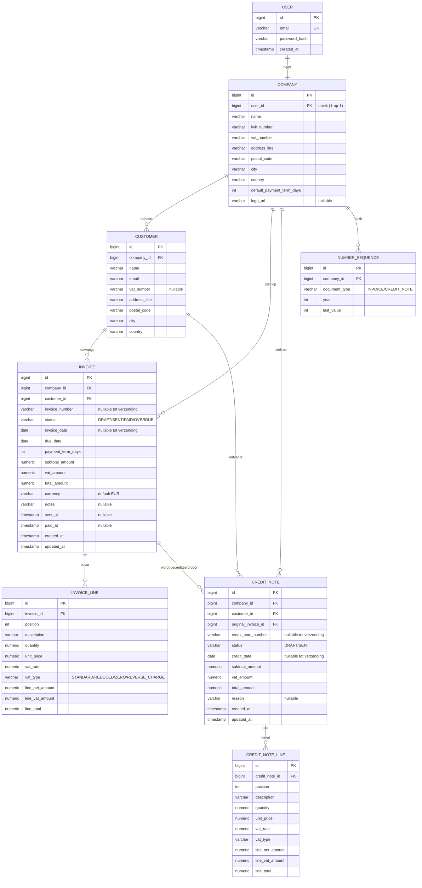

# Facturatie-app — Datamodel

Dit document beschrijft het datamodel van de facturatie-app: de entiteiten, hun velden en de relaties ertussen. Het vormt de basis voor de JPA-entities, de REST-endpoints en de eerste Flyway-migratie.

## ER-diagram

---

## Entiteiten in detail

### User
Het account waarmee de zzp'er inlogt. Bevat uitsluitend authenticatiegegevens; de zakelijke gegevens staan in Company.

| Veld | Type | Constraint / opmerking |
|------|------|------------------------|
| id | bigint | PK |
| email | varchar | uniek, verplicht |
| password_hash | varchar | verplicht (BCrypt) |
| created_at | timestamp | verplicht |

### Company
Het bedrijfsprofiel van de zzp'er. Deze gegevens verschijnen als afzender op de factuur. Eén User heeft precies één Company (1-op-1).

| Veld | Type | Constraint / opmerking |
|------|------|------------------------|
| id | bigint | PK |
| user_id | bigint | FK → User, uniek |
| name | varchar | verplicht |
| kvk_number | varchar | verplicht |
| vat_number | varchar | verplicht (eigen BTW-nummer) |
| address_line | varchar | verplicht |
| postal_code | varchar | verplicht |
| city | varchar | verplicht |
| country | varchar | verplicht (ISO-landcode, default NL) |
| default_payment_term_days | int | default bijv. 30 |
| logo_url | varchar | nullable (Should-have) |

### Customer
Een klant van de zzp'er, die facturen ontvangt. Hoort altijd bij één Company.

| Veld | Type | Constraint / opmerking |
|------|------|------------------------|
| id | bigint | PK |
| company_id | bigint | FK → Company |
| name | varchar | verplicht |
| email | varchar | verplicht |
| vat_number | varchar | nullable (nodig voor BTW verlegd / VIES) |
| address_line | varchar | verplicht |
| postal_code | varchar | verplicht |
| city | varchar | verplicht |
| country | varchar | verplicht (ISO-landcode) |

### Invoice
Een factuur. Kent een levenscyclus via `status`. Belangrijk: het definitieve `invoice_number`, de `invoice_date` en de berekende totalen worden pas vastgelegd bij verzending.

| Veld | Type | Constraint / opmerking |
|------|------|------------------------|
| id | bigint | PK |
| company_id | bigint | FK → Company (eigenaar) |
| customer_id | bigint | FK → Customer |
| invoice_number | varchar | nullable in DRAFT; toegekend bij verzending; uniek per company per jaar |
| status | varchar (enum) | DRAFT / SENT / PAID / OVERDUE |
| invoice_date | date | nullable tot verzending |
| due_date | date | afgeleid van invoice_date + payment_term_days |
| payment_term_days | int | overgenomen van Company, per factuur aanpasbaar |
| subtotal_amount | numeric(12,2) | snapshot, berekend door InvoiceCalculator |
| vat_amount | numeric(12,2) | snapshot |
| total_amount | numeric(12,2) | snapshot |
| currency | varchar | default EUR |
| notes | varchar | nullable |
| sent_at | timestamp | nullable |
| paid_at | timestamp | nullable |
| created_at | timestamp | verplicht |
| updated_at | timestamp | verplicht |

### InvoiceLine
Een regel op een factuur. Het BTW-tarief en -type worden hier **historisch** opgeslagen, zodat een oude factuur niet verandert als je later je BTW-instellingen aanpast. De regelbedragen zijn een snapshot van de berekening.

| Veld | Type | Constraint / opmerking |
|------|------|------------------------|
| id | bigint | PK |
| invoice_id | bigint | FK → Invoice |
| position | int | volgorde van de regels |
| description | varchar | verplicht |
| quantity | numeric(12,3) | ondersteunt fractionele aantallen (bijv. 0,5 uur) |
| unit_price | numeric(12,2) | prijs per eenheid |
| vat_rate | numeric(5,2) | toegepast percentage, bijv. 21.00 |
| vat_type | varchar (enum) | STANDARD / REDUCED / ZERO / REVERSE_CHARGE |
| line_net_amount | numeric(12,2) | = quantity × unit_price |
| line_vat_amount | numeric(12,2) | = line_net_amount × vat_rate |
| line_total | numeric(12,2) | = line_net_amount + line_vat_amount |

### CreditNote
Een creditnota die een bestaande, verzonden factuur (deels) crediteert. Verwijst altijd naar de originele factuur. Heeft een eigen nummerreeks, los van facturen.

| Veld | Type | Constraint / opmerking |
|------|------|------------------------|
| id | bigint | PK |
| company_id | bigint | FK → Company (eigenaar) |
| customer_id | bigint | FK → Customer |
| original_invoice_id | bigint | FK → Invoice (welke factuur wordt gecrediteerd) |
| credit_note_number | varchar | nullable in DRAFT; toegekend bij verzending; eigen reeks |
| status | varchar (enum) | DRAFT / SENT |
| credit_date | date | nullable tot verzending |
| subtotal_amount | numeric(12,2) | snapshot, negatief (creditering) |
| vat_amount | numeric(12,2) | snapshot, negatief |
| total_amount | numeric(12,2) | snapshot, negatief |
| reason | varchar | nullable (reden van creditering) |
| created_at | timestamp | verplicht |
| updated_at | timestamp | verplicht |

### CreditNoteLine
Regels van de creditnota. Zelfde opbouw als InvoiceLine, met één verschil: `quantity` en `unit_price` blijven positief (de regel leest natuurlijk, bijv. "1 × €100"), maar de berekende bedragen (`line_net_amount`, `line_vat_amount`, `line_total`) worden **negatief** opgeslagen, omdat het een creditering betreft. De `InvoiceCalculator` past dat teken toe.

| Veld | Type | Constraint / opmerking |
|------|------|------------------------|
| id | bigint | PK |
| credit_note_id | bigint | FK → CreditNote |
| position | int | volgorde |
| description | varchar | verplicht |
| quantity | numeric(12,3) | positief |
| unit_price | numeric(12,2) | positief |
| vat_rate | numeric(5,2) | |
| vat_type | varchar (enum) | |
| line_net_amount | numeric(12,2) | negatief |
| line_vat_amount | numeric(12,2) | negatief |
| line_total | numeric(12,2) | negatief |

### NumberSequence
De teller waarmee factuur- en creditnotanummers concurrency-safe worden uitgegeven. Eén rij per combinatie van company, documenttype en jaar. Bij het toekennen van een nummer wordt deze rij binnen een transactie gelockt en opgehoogd.

| Veld | Type | Constraint / opmerking |
|------|------|------------------------|
| id | bigint | PK |
| company_id | bigint | FK → Company |
| document_type | varchar (enum) | INVOICE / CREDIT_NOTE |
| year | int | boekjaar |
| last_value | int | laatst uitgegeven volgnummer |

> Uniek: (company_id, document_type, year)

---

## Enums

- **InvoiceStatus:** `DRAFT`, `SENT`, `PAID`, `OVERDUE`
- **CreditNoteStatus:** `DRAFT`, `SENT`
- **VatType:** `STANDARD` (21%), `REDUCED` (9%), `ZERO` (0%), `REVERSE_CHARGE` (BTW verlegd)
- **DocumentType:** `INVOICE`, `CREDIT_NOTE`

---

## Hoe de ontwerpkeuzes in het schema landen

**1. Factuurnummer pas bij verzending, concurrency-safe**
`invoice_number` en `invoice_date` zijn nullable zolang de factuur DRAFT is. Bij de overgang naar SENT vraagt de service een nummer op via de `NUMBER_SEQUENCE`-rij voor (company, INVOICE, jaar): die rij wordt gelockt, `last_value` opgehoogd en het nieuwe nummer teruggegeven — allemaal binnen dezelfde transactie. Twee gelijktijdige verzend-acties kunnen zo nooit hetzelfde nummer krijgen, en een verwijderd concept verbruikt geen nummer.

**2. Creditnota gekoppeld aan de originele factuur**
`CREDIT_NOTE.original_invoice_id` legt de relatie vast. De creditnota heeft een eigen nummerreeks (via `document_type = CREDIT_NOTE` in `NUMBER_SEQUENCE`), een eigen statusflow en een eigen PDF.

**3. BTW historisch vastgelegd**
`vat_rate` en `vat_type` staan op de regel (InvoiceLine / CreditNoteLine), niet op een centrale productconfiguratie. De berekende regelbedragen zijn een snapshot. Een factuur uit 2026 blijft dus tonen wat er destijds gold.

**4. Geld correct**
Alle bedragen zijn `numeric` (in Java `BigDecimal`), met vaste precisie en schaal. De berekening (regelbedrag → BTW → totaal) leeft in een aparte `InvoiceCalculator`-service met expliciete afronding; de uitkomsten worden als snapshot opgeslagen op de regel en op de factuur.

**5. Data-ownership**
Elke domeinentiteit hangt via `company_id` (en Company via `user_id`) aan één gebruiker. Elke query filtert op de eigenaar, zodat gebruiker A nooit bij data van gebruiker B kan.

**6. Onveranderlijkheid na verzending**
Zodra `status = SENT`, blokkeert de servicelaag wijzigingen aan de regels en bedragen. De opgeslagen snapshot-totalen ondersteunen dit: ze veranderen niet meer mee.

---

## Ontwerpkeuzes (besloten)
- **Bedragen op de creditnota:** worden **negatief** opgeslagen. Dat is overzichtelijker voor de gebruiker en maakt optellen in rapportages eenvoudig (factuur +€121, creditnota −€40, saldo €81).
- **Gedeeltelijk en volledig crediteren:** beide mogelijk. Eén factuur kan meerdere (deel)creditnota's hebben. Validatieregel: het totaal aan credit mag niet méér zijn dan het nog niet-gecrediteerde bedrag van de originele factuur.
- **Aparte regeltabellen (InvoiceLine / CreditNoteLine):** bewust twee tabellen, elk met één schone, afdwingbare foreign key naar hun eigen kop. Een gedeelde regeltabel zou een polymorfe foreign key vereisen, die je in een relationele database niet netjes met een constraint kunt afdwingen. Codeduplicatie in Java wordt voorkomen met een gedeelde basisklasse (`@MappedSuperclass`).
